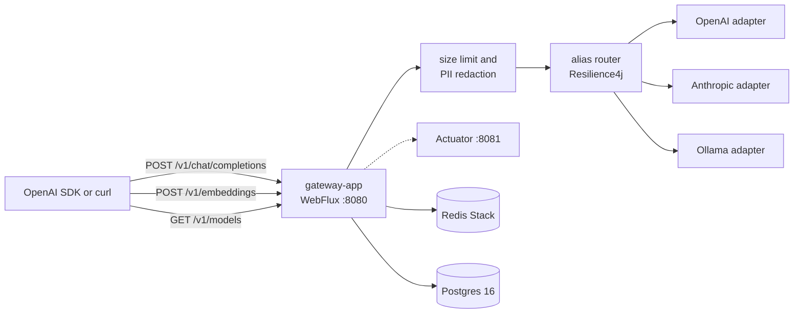

# jvm-llm-gateway

[](LICENSE)
[](https://openjdk.org/projects/jdk/21/)
[](https://github.com/guptagautam768/jvm-llm-gateway/actions/workflows/ci.yml)

OpenAI-compatible LLM gateway for the JVM. Application teams point an OpenAI SDK at one base URL. The gateway owns provider access, alias routing, resilience, caller tenancy, a usage ledger, response caching, and PII redaction before a prompt leaves the process.

This is platform infrastructure for Gautam Gupta's portfolio, not a RAG or agent product. Requirements: [SDR-0001](docs/sdr/0001-jvm-llm-gateway-sdr.md) (APPROVED v1.0). Decisions: [ADR index](#adr-index) (ADR-0001 through ADR-0015 Accepted). Release notes: [v1.0.0](docs/releases/v1.0.0.md) (2026-10-31).

## Architecture



Chat and embeddings share auth, the Redis token bucket, budgets, the ledger, and redaction. Non-streaming chat also uses the exact and semantic caches in Redis. Embeddings are not response-cached. `GET /v1/models` is the routing table and does not need a caller key. Actuator stays on port 8081.

| Module | Role |
|---|---|
| `gateway-app` | Spring Boot application, WebFlux handlers, actuator, wiring |
| `gateway-api` | OpenAI wire DTOs and the error body |
| `gateway-core` | `ProviderClient`, registry, alias router, Resilience4j. No web types |
| `gateway-providers` | OpenAI, Anthropic, and Ollama WebClient adapters |
| `gateway-cache` | Exact and semantic response cache on Redis Stack |
| `gateway-tenancy` | API key hash, Redis token bucket, budget counters, price math |
| `gateway-persistence` | Flyway schema, R2DBC tenant lookup, async ledger, partition retention |
| `gateway-guardrails` | Request size limit and PII redact-and-forward |
| `build-logic` | Java 21 convention plugins and JaCoCo |

## What it does

- `POST /v1/chat/completions` for JSON and for SSE when `stream` is true, including `data: [DONE]`.
- `POST /v1/embeddings` for a string or an array of strings. The response is OpenAI-shaped (`object: list`, `data[].embedding`).
- `GET /v1/models` from the routing table. It does not call a provider.
- YAML aliases (`fast`, `smart`, `embed`) with ordered fallback. A concrete model name that appears on one provider calls that provider only.
- Resilience4j per target, outermost first: time limiter, circuit breaker, retry. One breaker per `(provider, model)`.
- Caller keys `Authorization: Bearer lgw_<keyId>_<secret>`, or the `api-key` header when `Authorization` is absent. Keys are stored as SHA-256. `GET /v1/models` stays open.
- Redis token bucket, optional tokens-per-minute bucket, and token and dollar budgets. A cache hit still spends a request token. It does not add provider spend.
- Async Postgres usage ledger, partitioned by day, retained 30 days. Rows have no prompt or completion text.
- Exact and semantic response cache for non-streaming chat. `X-Cache` is `exact`, `semantic`, `miss`, `bypass`, or `skip`. `X-Cache-Bypass: true` skips lookup and write. Streams are not cached.
- PII redact-and-forward before the cache and the provider. Regex detectors: email, phone, credit card (Luhn), IPv4, IPv6, IBAN, PAN, Aadhaar. This is a baseline, not a compliance guarantee. Responses are not scanned and placeholders are not put back.
- OpenAI, Anthropic (chat and SSE), and Ollama (chat, NDJSON streaming, embeddings). Ollama is zero-cost unless a price row says otherwise.
- Micrometer `gateway.*` metrics and optional OTLP traces. Prometheus and Grafana are behind the Compose `observability` profile.

## Quickstart

Java 21. Docker is required for Compose and for the Testcontainers tests. WireMock tests do not need a provider key or a running model.

```bash
git clone https://github.com/guptagautam768/jvm-llm-gateway.git
cd jvm-llm-gateway
python -c "import os,base64; print('GATEWAY_BOOTSTRAP_KEY_ID='+os.urandom(4).hex()); print('GATEWAY_BOOTSTRAP_KEY_SECRET='+base64.urlsafe_b64encode(os.urandom(32)).decode().rstrip('='))"
```

Put the two lines in `.env` (see `.env.example`). The value you send is `lgw_<key id>_<secret>`. Leave the secret empty and every chat or embeddings call is **401**.

Paid providers:

```bash
export OPENAI_API_KEY=sk-...          # raw key, not a Bearer prefix
export ANTHROPIC_API_KEY=sk-ant-...   # optional; needed for Anthropic targets
docker compose up --build
```

No paid keys, using Ollama:

```bash
docker compose -f docker-compose.yml -f docker-compose.ollama.yml up --build
docker compose exec ollama ollama pull llama3.2
docker compose exec ollama ollama pull nomic-embed-text
```

`llama3.2` and `nomic-embed-text` are the profile defaults. `nomic-embed-text` publishes 768-dimensional vectors. If Redis already has the default 1536-dimension index, drop it before switching profiles: `FT.DROPINDEX gateway:cache:semantic`. The overlay sets `SPRING_PROFILES_ACTIVE=ollama`, which points `fast`, `smart`, `embed`, and the semantic cache at Ollama.

Scripted demo against WireMock (no model download, no paid key):

```bash
./scripts/demo.sh
```

The script starts Postgres, Redis, WireMock, and the gateway, then exercises chat, streaming, an exact cache hit, PII redaction, a 429, and embeddings. It generates a caller key in memory and tears the stack down on exit.

Compose publishes the API on port 8080 and the management port on `127.0.0.1:8081` only. Postgres 16 and Redis Stack start first. The gateway migrates the schema and bootstraps the tenant key.

Run on the host instead of in a container:

```bash
export OPENAI_API_KEY=sk-...
export ANTHROPIC_API_KEY=sk-ant-...
export OLLAMA_BASE_URL=http://127.0.0.1:11434
export SPRING_R2DBC_URL=r2dbc:postgresql://localhost:5432/gateway
export SPRING_R2DBC_USERNAME=gateway
export SPRING_R2DBC_PASSWORD=gateway
export SPRING_DATASOURCE_URL=jdbc:postgresql://localhost:5432/gateway
export SPRING_DATASOURCE_USERNAME=gateway
export SPRING_DATASOURCE_PASSWORD=gateway
export SPRING_FLYWAY_URL=jdbc:postgresql://localhost:5432/gateway
export SPRING_FLYWAY_USER=gateway
export SPRING_FLYWAY_PASSWORD=gateway
export SPRING_DATA_REDIS_HOST=localhost
export GATEWAY_BOOTSTRAP_KEY_ID=...
export GATEWAY_BOOTSTRAP_KEY_SECRET=...
./gradlew :gateway-app:bootRun
```

`docker compose up postgres redis` is enough for that path. Add `ollama` when you want the local provider. Flyway uses JDBC. The request path uses R2DBC and Lettuce.

`OPENAI_BASE_URL` and `ANTHROPIC_BASE_URL` override those origins. Paths are appended by the adapter (`/v1/chat/completions`, `/v1/embeddings`, `/v1/messages`). The base URL should not already include `/v1`. `OLLAMA_BASE_URL` defaults to `http://127.0.0.1:11434` (Compose uses `http://ollama:11434`). `OLLAMA_API_KEY` is optional.

Observability profile (Prometheus, Grafana, an OTLP collector, Jaeger):

```bash
OTEL_TRACES_EXPORT_ENABLED=true docker compose --profile observability up --build
```

Grafana is on `127.0.0.1:3000`, Prometheus on `127.0.0.1:9090`, Jaeger on `127.0.0.1:16686`. Export stays off unless that variable is true, so a process without a collector does not log connection errors.

## Examples

Caller key in the examples below:

```bash
export GATEWAY_TOKEN="lgw_${GATEWAY_BOOTSTRAP_KEY_ID}_${GATEWAY_BOOTSTRAP_KEY_SECRET}"
```

Alias chat:

```bash
curl -s http://localhost:8080/v1/chat/completions \
  -H "Authorization: Bearer ${GATEWAY_TOKEN}" \
  -H 'Content-Type: application/json' \
  -d '{"model":"fast","messages":[{"role":"user","content":"Say hello in one sentence."}]}'
```

The JSON `model` in the response is the alias you sent. The provider is called with the concrete model.

Streaming:

```bash
curl -N http://localhost:8080/v1/chat/completions \
  -H "Authorization: Bearer ${GATEWAY_TOKEN}" \
  -H 'Content-Type: application/json' \
  -H 'Accept: text/event-stream' \
  -d '{"model":"fast","stream":true,"messages":[{"role":"user","content":"Count to three."}]}'
```

Exact cache. The second identical call should send `X-Cache: exact` and should not call the provider. An omitted temperature skips the semantic cache and still uses the exact cache. `temperature` of at most 0.2 can also use the semantic cache.

```bash
curl -sD - http://localhost:8080/v1/chat/completions \
  -H "Authorization: Bearer ${GATEWAY_TOKEN}" \
  -H 'Content-Type: application/json' \
  -d '{"model":"gpt-4o-mini","temperature":0,"messages":[{"role":"user","content":"Say hello in one sentence."}]}'
```

Force the provider:

```bash
curl -sD - http://localhost:8080/v1/chat/completions \
  -H "Authorization: Bearer ${GATEWAY_TOKEN}" \
  -H 'X-Cache-Bypass: true' \
  -H 'Content-Type: application/json' \
  -d '{"model":"gpt-4o-mini","temperature":0,"messages":[{"role":"user","content":"Say hello in one sentence."}]}'
```

Embeddings:

```bash
curl -s http://localhost:8080/v1/embeddings \
  -H "Authorization: Bearer ${GATEWAY_TOKEN}" \
  -H 'Content-Type: application/json' \
  -d '{"model":"embed","input":"What is an embedding?"}'
```

`embed` tries OpenAI `text-embedding-3-small`, then Ollama `nomic-embed-text`. With the Ollama profile it tries only `nomic-embed-text`. A prompt that contains an email is forwarded with a placeholder such as `[EMAIL_1]`. The raw address is not sent and is not stored.

Models and health:

```bash
curl -s http://localhost:8080/v1/models
curl -s http://127.0.0.1:8081/actuator/health
curl -s http://127.0.0.1:8081/actuator/prometheus | head
```

## Routes, errors, and limits

The shipped aliases are illustrative. `fast` tries OpenAI `gpt-4o-mini`, then Anthropic `claude-haiku-4-5` (30s). `smart` tries OpenAI `gpt-4o`, then Anthropic `claude-sonnet-4-5` (60s). `embed` tries OpenAI `text-embedding-3-small`, then Ollama `nomic-embed-text` (30s). Edit `gateway.routes` and restart. Hot reload is not supported.

`max-attempts` includes the first call, so `2` means one retry. 4xx other than 429 is returned as-is and is not retried or fallen back. 429, 5xx, 529, connection failure, and timeout fall through the chain. After the chain is exhausted, 5xx and connection failures are **502** `upstream_unavailable`, timeouts are **504** `provider_timeout`, and an open breaker with nowhere left to go is **502** `circuit_open`. A provider 429 that survives the chain stays **429**. Streaming may fall back only before the first chunk. After that, the stream ends with an error event and no `data: [DONE]`.

A target that cannot embed (Anthropic) is skipped on `POST /v1/embeddings`. That skip is not a fallback. If no target can embed, the client gets **501** `not_implemented`.

The route timeout is the deadline for one target, including its retries. The next target gets its own deadline. Worst case for an alias is about `targets × timeout` when every target hangs. `fast` in the shipped file is two targets and 30s, so a fully hung route is about 60s before **504**. That figure is configuration arithmetic, not a measured latency.

| HTTP | `error.code` | When |
|---|---|---|
| 400 | `invalid_request`, `invalid_json`, `pii_detected` | Bad body, or reject-mode PII |
| 401 | `invalid_api_key` | Missing or unknown caller key |
| 403 | `tenant_disabled` | Key is valid and the tenant is disabled |
| 404 | `not_found` | Unknown path |
| 405 | `method_not_allowed` | Wrong method |
| 413 | `request_too_large` | Redacted text is over 1 MiB |
| 429 | `rate_limit_exceeded`, `token_budget_exceeded`, `cost_budget_exceeded` | Bucket or budget. `Retry-After` and `X-RateLimit-*` are set |
| 501 | `not_implemented` | No target can embed |
| 502 | `upstream_unavailable`, `circuit_open`, `provider_unavailable` | Chain exhausted, or the provider could not be reached |
| 503 | `provider_not_configured`, `dependency_unavailable` | Missing provider credential, or Redis/Postgres failed closed on the auth path |
| 504 | `provider_timeout` | Deadline exceeded |

Error bodies are `{ "error": { "message", "type", "code", "param" } }`. Provider 4xx bodies that are already OpenAI-shaped are passed through. Anthropic and Ollama errors are rewritten into that shape.

Semantic cache default threshold is **0.92**, with `temperature` of at most **0.2**. An omitted temperature counts as 1.0 for that gate only, which is OpenAI's default, so those calls skip the semantic cache. 0.92 is the cosine of about 23°: a 15° near-duplicate (about 0.966) hits and a 30° related prompt (about 0.866) misses. CI stubs vectors on both sides of the line. This is a correctness default, not a measured hit rate against a live embedding model. Tune it per alias with `gateway.routes.<alias>.cache.threshold`, or set `semantic: false`.

No load test has been run. SDR NFR-001 (p95 gateway overhead ≤ 50 ms, exact-cache hit ≤ 30 ms) is still a proposed target, not a measured result. Do not treat it as an SLO.

Prices in `gateway.prices` are a configured estimate table (USD per 1K tokens), including published OpenAI list prices for `text-embedding-3-small` ($0.00002 / 1K) and `text-embedding-3-large` ($0.00013 / 1K). They are not invoice reconciliation. A model with no row stores a null cost and increments `gateway.price.missing`, except Ollama, which defaults to 0 USD. An explicit row overrides that default.

Shutdown is graceful (`server.shutdown=graceful`, 20s). The async ledger then drains for up to 5 seconds. The client does not wait for the ledger insert. A failed insert is logged and counted on `gateway.ledger.writes`.

Startup fails on an unknown provider, a blank route, the same concrete model on two providers, a target that cannot chat, a base URL that is not absolute http(s), or a semantic-cache provider that does not exist or cannot embed. A missing API key does not fail startup. That target is skipped at request time, and semantic lookup misses until the key is set.

## Tests

```bash
./gradlew build
```

WireMock stands in for OpenAI, Anthropic, and Ollama. `TenancyLedgerIT` and `ResponseCacheIT` use Testcontainers (`postgres:16` and `redis/redis-stack-server`). `EmbeddingsWebTest` covers the embeddings route, Ollama chat and streaming, PII on embedding input, and a contract test with the official OpenAI Java SDK pointed at the gateway. `./gradlew build` writes per-module JaCoCo reports and an aggregate at `build/reports/jacoco/jacocoRootReport/`. There is no coverage gate. ADR-0011 sets that after a measured baseline, and this README does not invent one.

## ADR index

| ADR | Title | Status |
|---|---|---|
| [0001](docs/adr/0001-record-architecture-decisions.md) | Record architecture decisions | Accepted |
| [0002](docs/adr/0002-build-java21-spring-boot-gradle-multimodule.md) | Java 21, Spring Boot 3.x, Gradle multi-module | Accepted |
| [0003](docs/adr/0003-http-stack-spring-webflux.md) | WebFlux end to end | Accepted |
| [0004](docs/adr/0004-provider-abstraction-spring-ai.md) | `ProviderClient` port | Accepted; adapters amended by 0012, 0013, and 0015 |
| [0005](docs/adr/0005-routing-yaml-aliases-resilience4j.md) | YAML aliases and Resilience4j | Accepted |
| [0006](docs/adr/0006-caching-redis-exact-and-semantic.md) | Redis exact and semantic cache | Accepted |
| [0007](docs/adr/0007-tenancy-api-keys-rate-limits-budgets.md) | API keys, rate limits, budgets | Accepted |
| [0008](docs/adr/0008-persistence-postgres-flyway-usage-ledger.md) | Postgres ledger, 30-day retention | Accepted |
| [0009](docs/adr/0009-pii-redaction-pipeline.md) | PII redact-and-forward | Accepted |
| [0010](docs/adr/0010-observability-and-operations.md) | Micrometer, OTel, management port | Accepted |
| [0011](docs/adr/0011-testing-ci-and-licensing.md) | JUnit, WireMock, Testcontainers, JaCoCo, Apache-2.0 | Accepted |
| [0012](docs/adr/0012-openai-adapter-direct-webclient.md) | OpenAI WebClient adapter | Accepted |
| [0013](docs/adr/0013-anthropic-adapter-direct-webclient.md) | Anthropic WebClient adapter | Accepted |
| [0014](docs/adr/0014-guardrail-limits-and-week5-metrics.md) | Size limit, placeholders, week-5 metrics | Accepted |
| [0015](docs/adr/0015-ollama-webclient-and-public-embeddings.md) | Ollama WebClient adapter and public embeddings | Accepted |

Full index: [docs/adr/README.md](docs/adr/README.md).

## License

This project is [Apache-2.0](LICENSE). Copyright 2026 Gautam Gupta. See [NOTICE](NOTICE).

Redis Stack modules (RediSearch and the rest of the `redis/redis-stack-server` image) are **not** Apache-2.0. They ship under the Redis Source Available License / SSPL family. ADR-0006 records that. The gateway source does not vendor those modules.

## Documents

- [SDR-0001](docs/sdr/0001-jvm-llm-gateway-sdr.md)
- [ADR index](docs/adr/README.md)
- [Changelog](CHANGELOG.md)
- [Contributing](CONTRIBUTING.md)
- [v1.0.0 release notes](docs/releases/v1.0.0.md)
