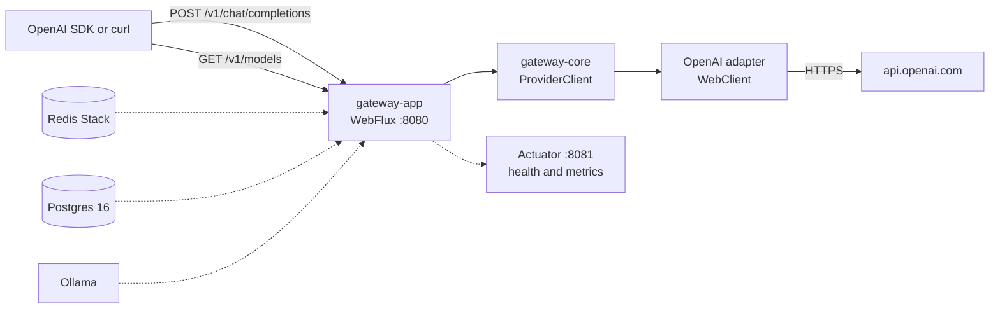

# jvm-llm-gateway

[](LICENSE)
[](https://openjdk.org/projects/jdk/21/)
[](https://github.com/guptagautam768/jvm-llm-gateway/actions/workflows/ci.yml)

OpenAI-compatible LLM gateway for the JVM. Application teams point an OpenAI SDK at one base URL; the gateway owns provider access, and later routing, resilience, tenancy, caching, guardrails, and a usage ledger.

This is a portfolio project for Gautam Gupta. It is platform infrastructure, not a RAG or agent product.

Requirements: [SDR-0001](docs/sdr/0001-jvm-llm-gateway-sdr.md) (APPROVED v1.0). Decisions: [ADR index](docs/adr/README.md) (ADR-0001 through ADR-0011, all Accepted).

## Week 1 status

Milestone: **skeleton + passthrough**.

Shipped:

- `POST /v1/chat/completions` for a normal JSON response and for SSE when `stream` is true, including the terminal `data: [DONE]` event.
- `GET /v1/models`.
- One provider, OpenAI, behind the `ProviderClient` port (`chat`, `stream`, `embed`, `capabilities`). Anthropic and Ollama ids are reserved; only OpenAI is implemented.
- Provider API key from `OPENAI_API_KEY`. It is never written to the repo.
- Actuator `health`, `info`, `metrics`, and `prometheus` on port **8081** only. The API port does not serve them.
- Docker Compose for Redis Stack, Postgres 16, and Ollama, plus a Dockerfile for the gateway. Week 1 code does not connect to those data services yet.
- Unit tests and a WireMock test that proves non-streaming and streaming passthrough without calling OpenAI.
- GitHub Actions runs `./gradlew build` on push and pull request and uploads the JaCoCo report.

Not in this milestone (see the roadmap): caller API keys, YAML aliases, fallback, Resilience4j, embeddings HTTP route, Redis cache, budgets, PII redaction, and the Postgres ledger.

## Architecture



Solid arrows are the week-1 request path. Dashed arrows are present in Compose or on the management port and are not on the chat path yet.

Module layout (ADR-0002):

| Module | Week 1 |
|---|---|
| `gateway-app` | Spring Boot application, WebFlux handlers, actuator, wiring |
| `gateway-api` | OpenAI wire DTOs and the error body |
| `gateway-core` | `ProviderClient` port, registry, request validation. No web types |
| `gateway-providers` | OpenAI adapter |
| `gateway-cache` | Placeholder for ADR-0006 |
| `gateway-tenancy` | Placeholder for ADR-0007 |
| `gateway-persistence` | Placeholder for ADR-0008 |
| `gateway-guardrails` | Placeholder for ADR-0009 |
| `build-logic` | Java 21 convention plugins and JaCoCo |

## Quickstart

Requirements: Java 21, and Docker with Compose if you want the dependency stack or the container image. Tests do not need an API key or Docker.

```bash
git clone https://github.com/guptagautam768/jvm-llm-gateway.git
cd jvm-llm-gateway
export OPENAI_API_KEY=sk-...   # raw key, not a Bearer prefix
docker compose up --build
```

Compose publishes the API on port 8080 and the management port on `127.0.0.1:8081` only. Postgres, Redis Stack, and Ollama start beside the app. Week 1 ignores them; a chat call still goes to OpenAI.

Non-streaming chat:

```bash
curl -s http://localhost:8080/v1/chat/completions \
  -H 'Content-Type: application/json' \
  -d '{"model":"gpt-4o-mini","messages":[{"role":"user","content":"Say hello in one sentence."}]}'
```

Streaming chat:

```bash
curl -N http://localhost:8080/v1/chat/completions \
  -H 'Content-Type: application/json' \
  -H 'Accept: text/event-stream' \
  -d '{"model":"gpt-4o-mini","stream":true,"messages":[{"role":"user","content":"Count to three."}]}'
```

Models and health:

```bash
curl -s http://localhost:8080/v1/models
curl -s http://127.0.0.1:8081/actuator/health
curl -s http://127.0.0.1:8081/actuator/prometheus | head
```

Run the gateway on the host instead of in a container:

```bash
export OPENAI_API_KEY=sk-...
./gradlew :gateway-app:bootRun
```

`OPENAI_BASE_URL` overrides the provider origin (default `https://api.openai.com`). Paths are `/v1/chat/completions` and `/v1/models`, so the base URL should not already include `/v1`.

If `OPENAI_API_KEY` is missing, the process still starts and chat or models return **503** `provider_not_configured`. A missing `model` or `messages` field returns **400** `invalid_request`. Provider HTTP errors are returned with the upstream status and the OpenAI error body. Connection failures are **502**. Timeouts are **504**.

Logs are JSON in Elastic Common Schema and do not include prompt text. Shutdown is graceful (`server.shutdown=graceful`).

### Tests

```bash
./gradlew build
```

WireMock stands in for OpenAI. `./gradlew build` also writes per-module JaCoCo reports and an aggregate at `build/reports/jacoco/jacocoRootReport/`. There is no coverage gate yet; ADR-0011 sets that after a baseline.

## Wire format

Requests and responses use snake_case. Modeled chat fields include `model`, `messages` (`role`, `content` as a string or array, `name`, `tool_calls`, `tool_call_id`), `temperature`, `top_p`, `n`, `stream`, `stream_options`, `stop`, `max_tokens`, `max_completion_tokens`, `presence_penalty`, `frequency_penalty`, `user`, `response_format`, `seed`, `tools`, `tool_choice`, `parallel_tool_calls`, and `logprobs`.

Unknown JSON fields are ignored and are not forwarded (FR-001, the "ignore" option). Null fields are omitted on the way out. The codec limit is 2MB until the request-size guardrail (FR-051) lands.

## Roadmap

| Week | Milestone | What it adds |
|---|---|---|
| 2 | Routing and resilience | YAML aliases and fallback chains, Resilience4j retry, circuit breaker, and time limiter (ADR-0005). Anthropic and Ollama adapters, then the embeddings route (ADR-0004, FR-002). |
| 3 | Tenancy and limits | Hashed API keys, Postgres tenants, Redis token bucket, token and dollar budgets, 429 contract (ADR-0007). Usage ledger schema and 30-day retention (ADR-0008). |
| 4 | Semantic cache | Redis exact-match and vector cache, TTL plus a size bound, `X-Cache-Bypass` (ADR-0006). |
| 5 | Guardrails and observability | PII redact-and-forward (ADR-0009), request size limits, the remaining Micrometer series, OpenTelemetry traces, Grafana dashboard (ADR-0010). |
| 6 | Polish | OpenAI Java SDK contract test, Testcontainers for Redis and Postgres, JaCoCo baseline gate, load-test notes, demo script. |

## License

This project is [Apache-2.0](LICENSE). Copyright 2026 Gautam Gupta. See [NOTICE](NOTICE).

Redis Stack modules (RediSearch and the rest of the `redis/redis-stack-server` image) are **not** Apache-2.0. They ship under the Redis Source Available License / SSPL family, with an AGPL option discussed for Redis 8. ADR-0006 records that, and ADR-0011 records Apache-2.0 for this repository. The gateway source does not vendor those modules. A dependency license report in CI is still to be wired (ADR-0011); it is not in the week-1 workflow.

## Documents

- [SDR-0001 — software design requirements](docs/sdr/0001-jvm-llm-gateway-sdr.md)
- [SDR review record](docs/sdr/REVIEW.md)
- [ADR index](docs/adr/README.md)
- [ADR review record](docs/adr/REVIEW.md)
