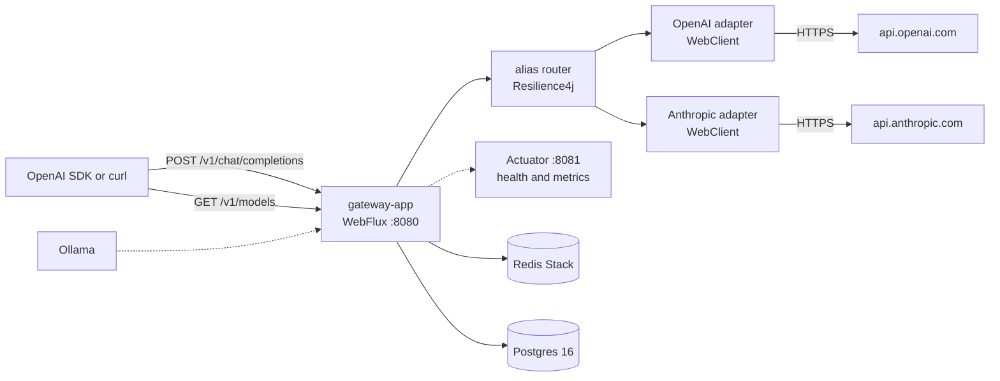

# jvm-llm-gateway

[](LICENSE)
[](https://openjdk.org/projects/jdk/21/)
[](https://github.com/guptagautam768/jvm-llm-gateway/actions/workflows/ci.yml)

OpenAI-compatible LLM gateway for the JVM. Application teams point an OpenAI SDK at one base URL. The gateway owns provider access, routing, resilience, caller tenancy, and a usage ledger. Caching and guardrails come later.

This is a portfolio project for Gautam Gupta. It is platform infrastructure, not a RAG or agent product.

Requirements: [SDR-0001](docs/sdr/0001-jvm-llm-gateway-sdr.md) (APPROVED v1.0). Decisions: [ADR index](docs/adr/README.md) (ADR-0001 through ADR-0013 Accepted).

## Week 1 status

Milestone: **skeleton + passthrough**.

Shipped:

- `POST /v1/chat/completions` for a normal JSON response and for SSE when `stream` is true, including the terminal `data: [DONE]` event.
- `GET /v1/models` (week 1 forwarded OpenAI's list; week 2 serves the routing table).
- OpenAI behind the `ProviderClient` port (`chat`, `stream`, `embed`, `capabilities`). Anthropic was added in week 2. The Ollama id is still reserved.
- Provider API key from `OPENAI_API_KEY`. It is never written to the repo.
- Actuator `health`, `info`, `metrics`, and `prometheus` on port **8081** only. The API port does not serve them.
- Docker Compose for Redis Stack, Postgres 16, and Ollama, plus a Dockerfile for the gateway. Week 1 code does not connect to those data services yet.
- Unit tests and a WireMock test that proves non-streaming and streaming passthrough without calling OpenAI.
- GitHub Actions runs `./gradlew build` on push and pull request and uploads the JaCoCo report.

Week 1 did not include caller API keys, YAML aliases, fallback, Resilience4j, the embeddings route, Redis cache, budgets, PII redaction, or the Postgres ledger. Aliases, fallback, Resilience4j, and Anthropic shipped in week 2.

## Week 2 status

Milestone: **routing and resilience**.

Shipped:

- YAML aliases under `gateway.routes`. A client `model` of `fast` or `smart` walks that alias's ordered targets. A concrete model name that appears on exactly one provider calls that provider only, with `gateway.resilience` as the timeout and retry, and does not borrow another alias's fallback chain.
- Resilience4j per target, outermost first: time limiter, circuit breaker, retry (ADR-0005). One breaker per `(provider, model)`. 4xx other than 429 is returned as-is and is not retried or fallen back. 429, 5xx, 529, connection failure, and timeout fall through the chain. After the chain is exhausted, 5xx and connection failures are **502** `upstream_unavailable`, timeouts are **504** `provider_timeout`, and an open breaker with nowhere left to go is **502** `circuit_open`. A provider 429 that survives the chain stays **429**.
- Streaming may fall back only before the first chunk. After that, a failure ends the stream with an error event and no `data: [DONE]`.
- Anthropic chat, including SSE, behind the same `ProviderClient` port. The edge stays OpenAI-shaped. The API key is `ANTHROPIC_API_KEY`. See [ADR-0013](docs/adr/0013-anthropic-adapter-direct-webclient.md) for why this adapter is WebClient rather than Spring AI.
- `GET /v1/models` lists configured aliases, then the concrete models on those routes. It does not call a provider.

Caller API keys, budgets, and the usage ledger shipped in week 3. Still later: Ollama (FR-012), `POST /v1/embeddings` (FR-002), Redis cache, and PII redaction.

The route timeout is the deadline for one target, including its retries. The next target gets its own deadline. Worst case for an alias is about `targets × timeout` when every target hangs. `fast` in the shipped file is two targets and 30s, so a fully hung route is about 60s before **504**. A 4xx fails immediately.

Resilience4j records one circuit-breaker result for the whole retry sequence (the breaker wraps the retry, as ADR-0005's decorator order says). A retry is not a second increment of the failure count.

## Week 3 status

Milestone: **tenancy, limits, and the usage ledger**.

Shipped:

- `POST /v1/chat/completions` requires a caller key. `Authorization: Bearer lgw_<keyId>_<secret>` is the primary form. The `api-key` header is accepted when `Authorization` is absent. `GET /v1/models` stays open.
- Keys are `key_id` plus SHA-256 of a secret that decodes to at least 32 bytes. Postgres stores the hash. Comparison uses `MessageDigest.isEqual`. A Caffeine cache (default 30s, `gateway.tenancy.cache-ttl`) keeps Postgres off the hot path, so a revocation shows up after that TTL.
- Bootstrap tenants and keys from `gateway.tenancy.bootstrap` / `GATEWAY_BOOTSTRAP_KEY_ID` and `GATEWAY_BOOTSTRAP_KEY_SECRET`. The process hashes the secret before insert. Real secrets stay in the environment. See `.env.example`.
- Redis Lua token bucket `rl:{tenant}` with `Retry-After` and `X-RateLimit-Limit`, `X-RateLimit-Remaining`, `X-RateLimit-Reset`. An optional tokens-per-minute bucket is `rl:{tenant}:tpm` when `tokens-per-minute` is set.
- Token and cost budgets in Redis at `budget:{tenant}:{windowStart}`. Pre-flight estimates prompt characters (about 4 per token) plus `max_tokens` / `max_completion_tokens` (or `gateway.tenancy.default-completion-tokens`). After the provider returns, the counter is replaced by actual usage. A stream that omits usage is charged the estimate. Concurrent requests can overshoot by a little; that is the ADR-0007 trade-off.
- Errors: **401** `invalid_api_key`, **403** `tenant_disabled`, **429** `rate_limit_exceeded` | `token_budget_exceeded` | `cost_budget_exceeded`. Redis or Postgres failures on this path are **503** `dependency_unavailable` (fail-closed, the policy ADR-0007 proposed).
- `usage_ledger` is range-partitioned by day. Writes are async. A failed write is logged and counted on `gateway.ledger.writes` and is not returned to the client. Rows have no prompt or completion text. `cache` is `none` until week 4.
- Estimated cost comes from `gateway.prices` (USD per 1K tokens). A missing model stores `est_cost_micros` null and increments `gateway.price.missing`.
- ShedLock (R2DBC, so JDBC stays on Flyway) runs `gateway.ledger.retention` (default 30 days): drop older daily partitions and pre-create upcoming ones.
- Metrics: `gateway.ratelimit.rejections` (`reason`), `gateway.tokens`, `gateway.cost.estimated`, `gateway.price.missing`. The `tenant` tag is off unless `gateway.tenancy.metrics-tenant-tag=true`.

## Architecture



Solid arrows are the chat path: auth and limits hit Redis, tenant lookup and the ledger hit Postgres. Ollama is in Compose only. The management port is separate from the API.

Module layout (ADR-0002):

| Module | Role |
|---|---|
| `gateway-app` | Spring Boot application, WebFlux handlers, actuator, wiring |
| `gateway-api` | OpenAI wire DTOs and the error body |
| `gateway-core` | `ProviderClient` port, registry, alias router, Resilience4j guard. No web types |
| `gateway-providers` | OpenAI and Anthropic adapters |
| `gateway-cache` | Placeholder for ADR-0006 |
| `gateway-tenancy` | API key hash and parse, Redis token bucket, budget counters, price math |
| `gateway-persistence` | Flyway schema, R2DBC tenant lookup, async ledger, partition retention |
| `gateway-guardrails` | Placeholder for ADR-0009 |
| `build-logic` | Java 21 convention plugins and JaCoCo |

## Quickstart

Requirements: Java 21. Docker is required for Compose and for the Testcontainers tests. The WireMock unit tests do not need a provider key.

```bash
git clone https://github.com/guptagautam768/jvm-llm-gateway.git
cd jvm-llm-gateway
export OPENAI_API_KEY=sk-...          # raw key, not a Bearer prefix
export ANTHROPIC_API_KEY=sk-ant-...   # optional; needed for Anthropic targets
docker compose up --build
```

Compose publishes the API on port 8080 and the management port on `127.0.0.1:8081` only. Postgres 16 and Redis Stack start first; the gateway migrates the schema and bootstraps the tenant key from the environment. Generate a caller key and put it in `.env` (never commit it):

```bash
python -c "import os,base64; print('GATEWAY_BOOTSTRAP_KEY_ID='+os.urandom(4).hex()); print('GATEWAY_BOOTSTRAP_KEY_SECRET='+base64.urlsafe_b64encode(os.urandom(32)).decode().rstrip('='))"
```

The value you send is `lgw_<key id>_<secret>`. Leave the secret empty and every chat call is **401**.

The shipped aliases are illustrative (ADR-0005). `fast` tries OpenAI `gpt-4o-mini`, then Anthropic `claude-haiku-4-5`. `smart` tries OpenAI `gpt-4o`, then Anthropic `claude-sonnet-4-5`. Edit `gateway.routes` in `gateway-app/src/main/resources/application.yml` and restart. A target whose provider has no API key is skipped. If every target is missing a key, the client gets **503** `provider_not_configured`.

```yaml
gateway:
  routes:
    fast:
      targets:
        - { provider: openai, model: gpt-4o-mini }
        - { provider: anthropic, model: claude-haiku-4-5 }
      timeout: 30s
      retry: { max-attempts: 2, backoff: 200ms, multiplier: 2 }
```

`max-attempts` includes the first call, so `2` means one retry. The backoff is the first wait; later waits grow by `multiplier`. The circuit breaker is global under `gateway.resilience.circuit-breaker`, one instance per `(provider, model)`.

Alias chat:

```bash
curl -s http://localhost:8080/v1/chat/completions \
  -H "Authorization: Bearer lgw_${GATEWAY_BOOTSTRAP_KEY_ID}_${GATEWAY_BOOTSTRAP_KEY_SECRET}" \
  -H 'Content-Type: application/json' \
  -d '{"model":"fast","messages":[{"role":"user","content":"Say hello in one sentence."}]}'
```

The JSON `model` in the response is the alias you sent. The provider is called with the concrete model.

A concrete name still works when it is configured on one provider:

```bash
curl -s http://localhost:8080/v1/chat/completions \
  -H "Authorization: Bearer lgw_${GATEWAY_BOOTSTRAP_KEY_ID}_${GATEWAY_BOOTSTRAP_KEY_SECRET}" \
  -H 'Content-Type: application/json' \
  -d '{"model":"gpt-4o-mini","messages":[{"role":"user","content":"Say hello in one sentence."}]}'
```

Streaming chat:

```bash
curl -N http://localhost:8080/v1/chat/completions \
  -H "Authorization: Bearer lgw_${GATEWAY_BOOTSTRAP_KEY_ID}_${GATEWAY_BOOTSTRAP_KEY_SECRET}" \
  -H 'Content-Type: application/json' \
  -H 'Accept: text/event-stream' \
  -d '{"model":"gpt-4o-mini","stream":true,"messages":[{"role":"user","content":"Count to three."}]}'
```

Models and health:

```bash
curl -s http://localhost:8080/v1/models
curl -s http://127.0.0.1:8081/actuator/health
curl -s http://127.0.0.1:8081/actuator/prometheus | head
```

Run the gateway on the host instead of in a container:

```bash
export OPENAI_API_KEY=sk-...
export ANTHROPIC_API_KEY=sk-ant-...   # optional
export SPRING_R2DBC_URL=r2dbc:postgresql://localhost:5432/gateway
export SPRING_R2DBC_USERNAME=gateway
export SPRING_R2DBC_PASSWORD=gateway
export SPRING_DATASOURCE_URL=jdbc:postgresql://localhost:5432/gateway
export SPRING_DATASOURCE_USERNAME=gateway
export SPRING_DATASOURCE_PASSWORD=gateway
export SPRING_FLYWAY_URL=jdbc:postgresql://localhost:5432/gateway
export SPRING_FLYWAY_USER=gateway
export SPRING_FLYWAY_PASSWORD=gateway
export SPRING_DATA_REDIS_HOST=localhost
export GATEWAY_BOOTSTRAP_KEY_ID=...
export GATEWAY_BOOTSTRAP_KEY_SECRET=...
./gradlew :gateway-app:bootRun
```

Postgres and Redis must already be up (`docker compose up postgres redis`). Flyway uses JDBC. The request path uses R2DBC and Lettuce.

`OPENAI_BASE_URL` overrides the OpenAI origin (default `https://api.openai.com`). Paths are `/v1/chat/completions` and, for the adapter only, `/v1/models`. The base URL should not already include `/v1`. `ANTHROPIC_BASE_URL` overrides the Anthropic origin (default `https://api.anthropic.com`); the adapter posts to `/v1/messages`.

`GET /v1/models` is served from the routing table, so it works without a caller key or a provider key. Chat without a valid caller key is **401** `invalid_api_key`. A valid key for a disabled tenant is **403** `tenant_disabled`. Over the request bucket or the token or dollar budget is **429** with `rate_limit_exceeded`, `token_budget_exceeded`, or `cost_budget_exceeded`, plus `Retry-After` and the `X-RateLimit-*` headers. Redis or Postgres being down on that path is **503** `dependency_unavailable`.

An unknown `model` is **400** `invalid_request`. A missing `model` or `messages` field is the same. A 4xx from a provider, other than 429, is returned with that status and the provider error body (Anthropic errors are rewritten into the OpenAI error shape). Provider 429 is retried and then falls back. After the chain is exhausted, provider 5xx and connection failures are **502**, and timeouts are **504**. A missing key for the only target is **503** `provider_not_configured`.

Anthropic requires `max_tokens`. If the client sends neither `max_tokens` nor `max_completion_tokens`, the gateway sends `gateway.providers.anthropic.default-max-tokens` (4096). Text content is translated. `n` greater than 1, and non-text content parts, are **400**. Tools, penalties, and `response_format` are not forwarded to Anthropic.

Logs are JSON in Elastic Common Schema and do not include prompt text. Shutdown is graceful (`server.shutdown=graceful`).

### Tests

```bash
./gradlew build
```

WireMock stands in for OpenAI and Anthropic. `TenancyLedgerIT` uses Testcontainers (`postgres:16` and `redis/redis-stack-server`, the same image as Compose) for AC-009 and AC-012: unknown keys, a disabled tenant, the rate-limit and budget 429s, ledger rows, budget reconcile, streaming usage, a missing price, and the retention job. `./gradlew build` also writes per-module JaCoCo reports and an aggregate at `build/reports/jacoco/jacocoRootReport/`. There is no coverage gate yet; ADR-0011 sets that after a baseline.

## Wire format

Requests and responses use snake_case. Modeled chat fields include `model`, `messages` (`role`, `content` as a string or array, `name`, `tool_calls`, `tool_call_id`), `temperature`, `top_p`, `n`, `stream`, `stream_options`, `stop`, `max_tokens`, `max_completion_tokens`, `presence_penalty`, `frequency_penalty`, `user`, `response_format`, `seed`, `tools`, `tool_choice`, `parallel_tool_calls`, and `logprobs`.

Unknown JSON fields are ignored and are not forwarded (FR-001, the "ignore" option). Null fields are omitted on the way out. The codec limit is 2MB until the request-size guardrail (FR-051) lands.

## Roadmap

| Week | Milestone | What it adds |
|---|---|---|
| 2 | Routing and resilience | **Done:** YAML aliases, ordered fallback, Resilience4j retry / circuit breaker / time limiter (ADR-0005), Anthropic chat and SSE. **Still open:** Ollama (FR-012) and `POST /v1/embeddings` (FR-002). |
| 3 | Tenancy and limits | **Done:** hashed API keys, Postgres tenants, Redis token bucket, token and dollar budgets, 429 contract (ADR-0007). Daily usage ledger and 30-day partition retention (ADR-0008). |
| 4 | Semantic cache | Redis exact-match and vector cache, TTL plus a size bound, `X-Cache-Bypass` (ADR-0006). |
| 5 | Guardrails and observability | PII redact-and-forward (ADR-0009), request size limits, the remaining Micrometer series, OpenTelemetry traces, Grafana dashboard (ADR-0010). |
| 6 | Polish | OpenAI Java SDK contract test, JaCoCo baseline gate, load-test notes, demo script. Testcontainers for limits and the ledger already run in week 3. |

## License

This project is [Apache-2.0](LICENSE). Copyright 2026 Gautam Gupta. See [NOTICE](NOTICE).

Redis Stack modules (RediSearch and the rest of the `redis/redis-stack-server` image) are **not** Apache-2.0. They ship under the Redis Source Available License / SSPL family, with an AGPL option discussed for Redis 8. ADR-0006 records that, and ADR-0011 records Apache-2.0 for this repository. The gateway source does not vendor those modules. A dependency license report in CI is still to be wired (ADR-0011); it is not in the week-1 workflow.

## Documents

- [SDR-0001 — software design requirements](docs/sdr/0001-jvm-llm-gateway-sdr.md)
- [SDR review record](docs/sdr/REVIEW.md)
- [ADR index](docs/adr/README.md)
- [ADR review record](docs/adr/REVIEW.md)
